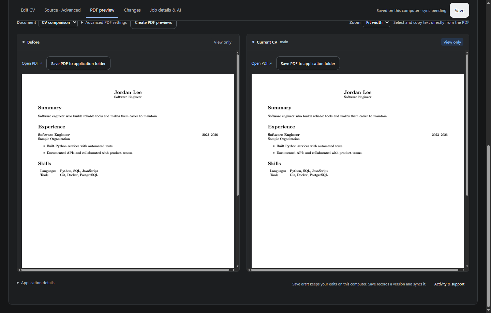

# Vita Tree

Browse, edit, and adapt LaTeX CVs across Git branches with side-by-side version comparison, structured editing, and live PDF previews.



## Quick start

### 1. Try the sample CV (fastest way to explore)

Explore Vita Tree immediately without preparing an existing LaTeX CV repository:

```sh
pipx install "vita-tree[ai]"
vt demo
```

Or using `uv`:

```sh
uv tool install "vita-tree[ai]"
vt demo
```

`vt demo` creates an isolated sample CV repository with a synthetic resume and job description, initializes a clean Git history, and opens the local dashboard at `http://127.0.0.1:8765`. It requires Git but works completely offline without network access, cloud provider accounts, or global Git identity configuration.

### 2. Open your own CV repository

```sh
vt run /path/to/your/cv-repository
```

On Windows:

```powershell
vt run "C:\path\to\cv-repository"
```

**Requirements:**
- **Git** and **Python 3.10+**.
- Your CV project must be a Git repository containing a UTF-8 LaTeX CV (`main.tex` at the repository root).
- Vita Tree does not import raw PDF or DOCX files directly; if you currently only have a PDF or DOCX, launch `vt demo` to try the editor and structure.

### 3. Guided setup scripts

To check system capabilities and set up prerequisites automatically:

**Windows (PowerShell or CMD):**

```powershell
powershell -ExecutionPolicy Bypass -File scripts\setup.ps1
```

**Linux and macOS:**

```bash
bash scripts/setup.sh
```

The script verifies compatible Python (>=3.10), Git, and optional TeX engines, guides you through any missing requirements, and offers to launch the sample demo.

---

## Installation options

| Installation method | Command | Best for |
| :--- | :--- | :--- |
| **pipx (Recommended)** | `pipx install "vita-tree[ai]"` | Isolated, globally available CLI tool |
| **uv tool** | `uv tool install "vita-tree[ai]"` | Fast, modern isolated tool installation |
| **pip user install** | `python -m pip install --user "vita-tree[ai]"` | Standard per-user Python environments |
| **From source** | `git clone https://github.com/ABDELLAH-Hallou/vita-tree.git && cd vita-tree && python -m pip install -e ".[ai]"` | Development and contributing |

`vita-tree` is available as an alias for `vt`; `python -m vita_tree` works in any environment where the package is installed.

### Extras and optional dependencies

- **`[ai]` extra**: Installs the compatible [VITA](https://github.com/ABDELLAH-Hallou/vita-cv) CLI and enables multi-provider model routing and reasoning. Install plain `vita-tree` if you only need local editing, branch comparison, and PDF previews.
- **PDF compilation (Optional)**: Install MiKTeX (Windows) or TeX Live (Linux/macOS) with your template's packages and fonts. Browsing, syntax checking, and structured editing work without TeX; TeX is only needed for PDF compilation.
- Browser assets, PDF.js, editor components, and fonts are bundled locally; no Node runtime or CDN connection is needed.

---

## Security and local execution

- **Localhost only:** The server binds to `127.0.0.1` and accepts localhost connections only. Never expose it through an untrusted public network proxy.
- **Trusted LaTeX compilation:** LaTeX compilers run with `-no-shell-escape`. Compile only trusted local LaTeX source code.
- **Privacy by design:** Logs exclude CV contents, prompts, and credentials. Secrets stay in memory and are never written to disk or Git history.

Read the full [Security policy](https://github.com/ABDELLAH-Hallou/vita-tree/blob/main/SECURITY.md) for details.

---

## Applications and saving

Choose **New application**, give it a natural name such as “Acme — ML Engineer”, and choose a starting CV. Vita Tree keeps the internal Git identifier separate from the displayed name. Existing names remain available without automatic reclassification as templates.

**Save draft** writes edits on this computer. **Save** records a version and syncs only the selected application to its connected destination after you review the changes and enter a change note. A failed sync preserves the local version and offers **Retry sync**. The status distinguishes unsaved edits, saved drafts, and versions waiting to sync; “Saved and synced” is shown only after a successful sync in the current session.

File paths, source filenames, PDF engine choices, and raw support events are available in expandable details. The source editor and advanced tooling remain available. Browser URLs, CLI commands, API fields, Git operations, and existing repository files retain their technical names for compatibility.

## Workflow

The LaTeX tab includes syntax colors, line numbers, bracket matching, undo/redo,
and search (Ctrl/Cmd+F). Live syntax checks underline parser errors; click the
status below the editor for details. Checks report the first syntax error and
do not validate custom macro expansion or installed packages; compile the PDF
for full validation. Unsaved and temporarily invalid source can still be saved.
The editor is bundled locally and follows the selected light/dark theme.

1. Open a branch. Existing checked-out branches display working files, including uncommitted `main.tex`, `job.md`, and `.vita/results/*.md`. Other branches display committed files.
2. Choose **Branch from this**, name the branch, and paste the job description. Vita Tree creates a Git linked worktree below the repository's Git common directory at `vita-tree/worktrees/`. The original checkout is not switched. The viewed main document and the new `job.md` are written to the new worktree.
3. In **Structure**, select/copy text normally, or double-click text in the new version to edit it. The parser maps text to its exact source range and escapes LaTeX special characters. **Source · Advanced** provides the full editable source for other changes. Save writes the branch worktree's real file.
4. In **Job & AI**, save the job description and select a provider, model, reasoning level, and language. Use **Prepare application** for every available AI step, **Start selected steps** for any checked subset, or select a graph node and choose **Run … only**. Each enabled step runs in order in an isolated snapshot. Different branches still run concurrently, without a queue.
5. Follow the **Application workflow** graph: extract → analyze → adapt → AI review → cover letter → validate. Select a task for its status, duration, output, and independent run action, or choose an earlier run. Actions always use the current saved branch files, even when inspecting an older run. Skipped tasks make no AI calls; failed tasks block downstream work. The validation task checks source structure and conflicts, not PDF compilation. Review the Markdown reports, changes, and compiled PDFs before committing.
6. Use **Save** to review the destination, commit message, and included files, then publish only the selected branch. A failed push leaves the commit safely in the worktree and offers a push-only retry.

**Save draft** remains local and uncommitted. **Save** includes only the displayed main document, `job.md`, the generated `cover-letter.tex`, and reviewed VITA Markdown/JSON/TOON reports; unrelated working-tree changes are reported and excluded. It never force-pushes or publishes other branches. Worktrees containing local changes persist across server restarts; leaving a clean worktree releases its branch for CLI checkout.

## What is supported and what is limited

| Capability | Status |
| --- | --- |
| Centered, responsive branch list and original/new comparison | Implemented |
| Actual LaTeX syntax parsing with positions | `pylatexenc` AST, not regex stripping |
| Common `resume.cls` content: names, addresses, rSection/rSubsection, formatting, bullets, tabularx | Structured reading view supported |
| Text selection and mapped editing | HTML reading view and PDF text layer; edits made in Structure/LaTeX update the source |
| Exact fonts, spacing, line breaks, page breaks | Compiled PDF is authoritative |
| Arbitrary macro expansion / exact HTML reproduction of every LaTeX package | Not supported; use PDF and source editing |
| Editing directly inside the compiled PDF | Not supported; PDF is read-only, then recompiled after source edits |
| `\\input` / `\\include`, custom classes, images | Included in compilation when present in the repository snapshot; included files are not visually editable in Structure |
| Multi-file uncommitted changes when creating a branch | Only the displayed main document is copied; other files come from the base commit |
| Bibliography, makeindex, minted/shell-escape builds | Not orchestrated; current compiler runs the selected TeX engine twice |
| Guaranteed perfect PDF reading order for arbitrary templates/fonts | Not possible; depends on the PDF's text encoding and layout |
| Successful AI generation for every provider | Depends on VITA credentials/provider availability; provider, validation, and conflict failures preserve the CV; inspect files after disk-write failures |

## Activity, errors, and logs

Open **Activity & support** in the sidebar or workspace footer for running/completed/failed run counts, request metrics, and recent events. Errors include a reference ID; paste it into the activity search to find the operation, error type, OS error code, and code location. **Download diagnostics** exports a sanitized snapshot without local log paths.

`vt run` prints the log filename and metrics URL at startup. Rotating JSON logs live outside the repository, under `%LOCALAPPDATA%\vita-tree\logs\<repository-id>` on Windows or `$XDG_STATE_HOME/vita-tree/logs/<repository-id>` on other platforms (default `~/.local/state`). Each server session keeps up to six 1 MB files. Logs exclude CV/job contents, prompts, credentials, request payloads, and raw provider output.

## Development and verification

```powershell
python -m pip install -e ".[test]"
python -m unittest discover -s tests -v
python -m playwright install chromium
python tests/browser_check.py --browser chromium
python tests/browser_jobs.py --browser chromium
python tests/browser_workflow.py --browser chromium
```

## Release and Changelog

- Consult the [Changelog](https://github.com/ABDELLAH-Hallou/vita-tree/blob/main/CHANGELOG.md) for version release notes.
- Maintainers should follow the [Maintainer release runbook](https://github.com/ABDELLAH-Hallou/vita-tree/blob/main/.github/RELEASING.md) for the two-stage TestPyPI and PyPI promotion procedure.

## Author

Created and maintained by [Abdellah HALLOU](https://github.com/ABDELLAH-Hallou),
the project's main contributor. Contact: [abdeallahhallou33@gmail.com](mailto:abdeallahhallou33@gmail.com).

Vita Tree is MIT licensed. Bundled PDF.js components retain their original licenses;
see [third-party notices](https://github.com/ABDELLAH-Hallou/vita-tree/blob/main/THIRD_PARTY_NOTICES.md).
