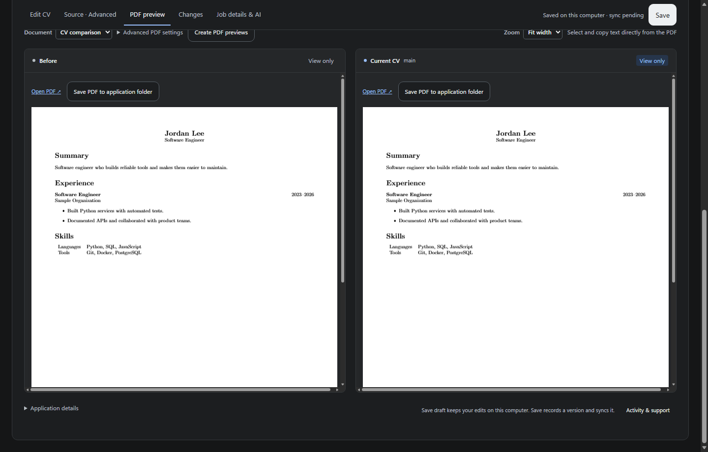

# Vita-Tree — LaTeX CV Editor and AI Application Workspace

Edit your LaTeX CV, compare tailored versions, and manage job applications in a local browser workspace.

Vita-Tree brings CV editing, Git version history, and PDF previews into one visual interface. Keep a separate CV version and job description for each application, review changes side by side, and check the compiled PDF before sending it.

With optional Vita-CV integration, you can analyze job descriptions, tailor your CV, review AI-generated changes, and generate cover letters using your configured AI provider.

- **Edit LaTeX CVs:** work with your existing LaTeX source and preview compiled PDFs.
- **Compare versions:** inspect changes between your starting CV and an application-specific version.
- **Organize applications:** keep CV variants and job descriptions together, backed by Git.
- **Run AI workflows:** prepare application materials and review the results before saving.
- **Try the demo:** explore a sample CV with `vt demo`, without an AI account or an existing CV repository.

## Vita-Tree and Vita-CV: what’s the difference?

**Vita-Tree is the visual workspace.** Use it to edit CVs, compare versions, preview PDFs, and run application workflows from your browser.

**[Vita-CV](https://github.com/ABDELLAH-Hallou/vita-cv) is the command-line tool.** It manages CVs as code and provides the AI workflows that Vita-Tree integrates.

Choose Vita-Tree for a visual interface or Vita-CV for a terminal-based workflow. Vita-Tree supports editing, comparisons, and PDF previews without the optional AI integration. Install `vita-tree[ai]` to add Vita-CV-powered AI workflows.

## Quick start

### Try the sample CV

With Python 3.10+, Git, and [pipx](https://pipx.pypa.io/stable/installation/) or [uv](https://docs.astral.sh/uv/getting-started/installation/) installed, use either path:

```sh
pipx install vita-tree
vt demo
```

```sh
uv tool install vita-tree
vt demo
```

The sample includes an editable CV and a fictional job description. After installation, the demo opens offline without TeX, a provider account, or an existing CV repository. To compile a PDF, install a local TeX distribution, then choose **Check CV files** in the workspace. Use `vt demo --no-browser` to print the local URL without opening a browser.



### Guided setup

Choose a [published Vita Tree release](https://pypi.org/project/vita-tree/#history) that includes the setup scripts. Replace `VERSION` below with its version number, such as `1.2.3`. The scripts install that version in a per-user Python environment and ask what you want to open. They check for Python and Git and give installation guidance when a system tool is missing.

**Windows · PowerShell or CMD**

```bat
set VT_VERSION=VERSION
curl.exe --fail --location "https://raw.githubusercontent.com/ABDELLAH-Hallou/vita-tree/v%VT_VERSION%/scripts/setup.ps1" --output setup.ps1 && powershell -NoProfile -ExecutionPolicy RemoteSigned -File .\setup.ps1 %VT_VERSION%
```

Run the Windows block in **CMD**. In PowerShell, run `cmd.exe` first, or use the following:

```powershell
$version = 'VERSION'
Invoke-WebRequest -UseBasicParsing -Uri "https://raw.githubusercontent.com/ABDELLAH-Hallou/vita-tree/v$version/scripts/setup.ps1" -OutFile setup.ps1
& .\setup.ps1 $version
```

**Linux and macOS · Bash**

```bash
version=VERSION
curl --fail --location "https://raw.githubusercontent.com/ABDELLAH-Hallou/vita-tree/v$version/scripts/setup.sh" --output setup.sh &&
  bash setup.sh "$version"
```

### Open your own CV

```sh
vt run "/path/to/your/cv-repository"
```

Use a Git repository with UTF-8 LaTeX source. AI preparation expects `main.tex` at the repository root. For viewing and PDF previews with a different entry file, pass `--file other.tex`. If you have a PDF or DOCX, use `vt demo` to explore the app first.

Install MiKTeX on Windows or TeX Live on Linux and macOS for PDF compilation. The project’s fonts and packages must be available locally. **Check CV files** shows which part of your setup needs attention. Compile only templates you trust and keep the app on localhost. [Security policy](https://github.com/ABDELLAH-Hallou/vita-tree/blob/main/SECURITY.md)

## AI preparation

Install `vita-tree[ai]` or choose optional AI support in guided setup. In **Job details & AI**, select a provider and connect your account. Use the [Vita CV setup guide](https://github.com/ABDELLAH-Hallou/vita-cv#readme) if you need to initialize your CV configuration.

See the [workspace guide](https://github.com/ABDELLAH-Hallou/vita-tree/blob/main/docs/WORKSPACE_GUIDE.md) for applications, editing, reports, approvals, and Jobenu imports. See the [changelog](https://github.com/ABDELLAH-Hallou/vita-tree/blob/main/CHANGELOG.md) for release notes.

Vita Tree is MIT licensed. Bundled components retain their original licenses. [Third-party notices](https://github.com/ABDELLAH-Hallou/vita-tree/blob/main/THIRD_PARTY_NOTICES.md)
